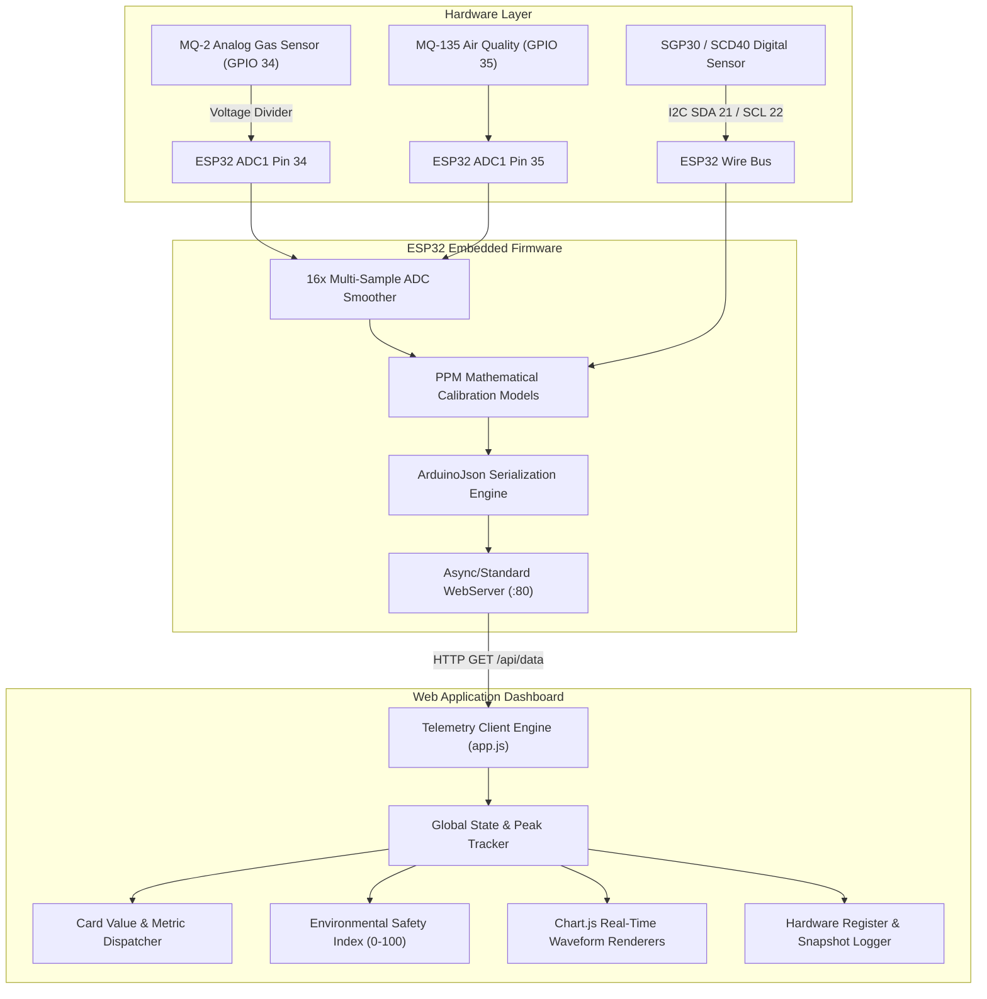

# 🌿 EmmiSense — Multi-Channel Environmental Gas & Air Quality Telemetry

<div align="center">


<p align="center">
  <b>A real-time, multi-sensor environmental telemetry system powered by ESP32 microcontrollers and a high-performance web dashboard with rolling waveform analytics, hardware register inspection, benchmark snapshot logging, and dynamic safety threshold alerting.</b>
</p>

</div>

---

## 📑 Table of Contents

- [🌟 System Overview](#-system-overview)
- [⚡ Key Features](#-key-features)
- [🔌 Hardware Pin Mapping & Circuit Wiring](#-hardware-pin-mapping--circuit-wiring)
- [🧪 Chemical Gas Target Matrix](#-chemical-gas-target-matrix)
- [🏗️ System Architecture](#-system-architecture)
- [📡 ESP32 REST API Specification](#-esp32-rest-api-specification)
- [💻 Web Dashboard Modules](#-web-dashboard-modules)
- [🚀 Quick Start Guide](#-quick-start-guide)
  - [1. ESP32 Firmware Upload](#1-esp32-firmware-upload)
  - [2. Launching the Web Dashboard](#2-launching-the-web-dashboard)
- [📁 Project Directory Structure](#-project-directory-structure)
- [⚙️ Configuration & Thresholds](#️-configuration--thresholds)
- [📄 License & Credits](#-license--credits)

---

## 🌟 System Overview

**EmmiSense** is an environmental safety platform combining embedded hardware sensing with client-side analytical visualization. Built to monitor both physical analog gas sensors (MQ-series on ESP32 ADC1 channels) and active digital I2C sensors, it provides reliable real-time environmental awareness for laboratories, cleanrooms, and testing facilities.

The web client operates with **zero external framework overhead**—built in pure Vanilla HTML5, modern CSS3 design tokens, and JavaScript, leveraging **Chart.js** for 60-point rolling real-time graphs.

---

## ⚡ Key Features

- 🟢 **Dual Hardware Analog Inputs**: High-precision 16x multi-sampled ADC reading on **GPIO 34 (MQ-2)** and **GPIO 35 (MQ-135)**.
- 🟣 **Calibrated Ambient Baselines**: Tailored ppm conversion curves designed to keep clean room ambient baseline readings realistic and low without artificial truncation.
- 🟠 **Full-Spectrum Multi-Channel Suite**: Dedicated telemetry cards for **MQ-2 (Combustible Gas/Smoke)**, **MQ-135 (Air Quality/Ammonia)**, **MQ-7 (Carbon Monoxide)**, **MQ-137 (Nitrogen Dioxide)**, **SCD40/SGP30 ($\text{CO}_2$ & TVOC)**, and **Ambient Meteorological Environment (Temp/Hum/Pressure)**.
- 📈 **Dynamic Live Charts**: Individual real-time rolling waveform canvases with custom brand palettes, smooth cubic bezier curves, and hover inspect tooltips.
- 🔬 **Hardware Register Monitor**: Live diagnostic table showing raw 12-bit ADC counts ($0\text{–}4095$), true calculated pin voltages ($0.0\text{–}5.0\text{ V}$), and round-trip polling latency ($\text{ms}$).
- 📸 **Timestamped Snapshot Benchmarking**: Capture instant sensor test states into a benchmark comparison table with test condition labels.
- 📥 **One-Click CSV Export**: Complete historical logging with ISO timestamps, ppm concentrations, raw ADC counts, voltages, and latency.
- 🚨 **Configurable Safety Thresholds**: On-the-fly adjustable Warning and Danger limit drawers with automatic UI state alarms (`SAFE`, `WARNING`, `DANGER`) persisted in browser `localStorage`.
- 🌐 **Dual Operation Modes**: Seamlessly toggle between **Live ESP32 Polling** (HTTP / WebSocket) and **Demo Simulation Mode** for hardware-free presentation and testing.

---

## 🔌 Hardware Pin Mapping & Circuit Wiring

| Sensor | Gas / Target | Hardware Interface | ESP32 Pin | Voltage Level | Notes |
| :--- | :--- | :--- | :--- | :--- | :--- |
| **MQ-2** | Combustible Gas / LPG / Smoke | Analog Out ($\text{A}_0$) | **GPIO 34** (ADC1_CH6) | $0.0\text{V} - 3.3\text{V}$ | Via $10\text{k}\Omega / 10\text{k}\Omega$ voltage divider ($2.0\times$ scaling in firmware) |
| **MQ-135** | Air Quality / Ammonia ($\text{NH}_3$) | Analog Out ($\text{A}_0$) | **GPIO 35** (ADC1_CH7) | $0.0\text{V} - 3.3\text{V}$ | Direct analog read |
| **SGP30 / SCD40** | $\text{eCO}_2$ & $\text{TVOC}$ | $\text{I}^2\text{C}$ Data ($\text{SDA}$) | **GPIO 21** | $3.3\text{V}$ | $4.7\text{k}\Omega$ pull-up recommended |
| **SGP30 / SCD40** | $\text{eCO}_2$ & $\text{TVOC}$ | $\text{I}^2\text{C}$ Clock ($\text{SCL}$) | **GPIO 22** | $3.3\text{V}$ | $4.7\text{k}\Omega$ pull-up recommended |

> [!NOTE]
> **Why ADC1 Pins?**
> ESP32 ADC2 channels (GPIO 0, 2, 4, 12-15, 25-27) are shared with the Wi-Fi subsystem and cannot be read reliably when Wi-Fi SoftAP is active. By restricting analog sensing to **ADC1** pins (GPIO 34 & 35), EmmiSense guarantees collision-free continuous ADC acquisition while streaming data over HTTP.

---

## 🧪 Chemical Gas Target Matrix

```
┌────────────────────────────────────────────────────────────────────────┐
│                        EMMISENSE SENSOR SUITE                         │
├──────────────┬───────────────────┬──────────────────┬──────────────────┤
│ Sensor Model │ Primary Gases     │ Normal Baseline  │ Warning / Danger │
├──────────────┼───────────────────┼──────────────────┼──────────────────┤
│ MQ-2         │ LPG, Smoke, CH₄   │ 1.05 - 1.30 ppm  │ > 15 / > 35 ppm  │
│ MQ-135       │ NH₃, Benzene, AQ  │ 0.08 - 0.12 ppm  │ > 15 / > 35 ppm  │
│ MQ-7         │ Carbon Monoxide   │ 1.60 - 2.10 ppm  │ > 9 / > 25 ppm   │
│ MQ-137       │ NO₂, Ammonia      │ 0.008 - 0.012 ppm│ > 0.05 / > 0.20  │
│ SGP30/SCD40  │ CO₂ / TVOC        │ 400 ppm / 18 ppb │ > 1000 / > 2000  │
│ Ambient BME  │ Temp / Humidity   │ 24.5 °C / 52 %   │ Thermal Comfort  │
└──────────────┴───────────────────┴──────────────────┴──────────────────┘
```

---

## 🏗️ System Architecture



---

## 📡 ESP32 REST API Specification

### Endpoint: `GET /api/data`
Returns a JSON telemetry packet containing active sensor ppm values, raw ADC counts, computed analog voltages, digital metrics, and latency.

#### Response Headers:
```http
HTTP/1.1 200 OK
Content-Type: application/json
Access-Control-Allow-Origin: *
Access-Control-Allow-Methods: GET, OPTIONS
```

#### Example Payload:
```json
{
  "mq2_ppm": 1.18,
  "mq135_ppm": 0.09,
  "mq2_adc": 749,
  "mq135_adc": 310,
  "mq2_volts": 1.21,
  "mq135_volts": 0.25,
  "co": 1.85,
  "mq7_co": 1.85,
  "mq7_adc": 480,
  "mq7_volts": 0.39,
  "no2": 0.009,
  "mq137_no2": 0.009,
  "mq137_adc": 290,
  "mq137_volts": 0.23,
  "scd40_co2": 408,
  "sgp30_tvoc": 18,
  "sgp30_eco2": 408,
  "sgp30_status": "ONLINE",
  "tvoc": 18,
  "voc": 18,
  "co2": 408,
  "temp": 24.5,
  "humidity": 52.0,
  "pressure": 1013.2,
  "nh3": 0.09,
  "raw": {
    "mq2_adc": 749,
    "mq135_adc": 310,
    "nh3_adc": 310,
    "co_adc": 480,
    "no2_adc": 290,
    "co2_val": 408
  }
}
```

---

## 💻 Web Dashboard Modules

### 1. Environmental Safety Index
An intelligent aggregate metric scoring overall contamination between **0 and 100**:
- **0 – 34**: `EXCELLENT / CLEAN` (Vibrant green indicator)
- **35 – 64**: `MODERATE CONTAMINATION` (Amber caution indicator)
- **65 – 100**: `HIGH SEVERITY` (Red warning alert with ventilation advice)

### 2. Multi-Channel Sensor Cards
Each card features:
- Live numerical concentration display with chemical formula tag
- Warning and Danger limit indicators
- Dedicated real-time Chart.js graph (5-minute rolling window)
- Raw 12-bit ADC count and voltage reading
- Session peak tracker

### 3. Hardware Register Monitor & Snapshot Bench
- Directly inspect microcontroller hardware registers in real-time.
- Click **"Log Timestamped Snapshot"** to store test conditions with a custom label (e.g., *"Baseline Test"*, *"Solvent Exposure"*, *"Ventilation Check"*).
- One-click **"Export CSV"** downloads the full data history formatted for spreadsheet analysis.

---

## 🚀 Quick Start Guide

### 1. ESP32 Firmware Upload
1. Open [EmmiSense/EmmiSense.ino](file:///d:/DOCUMENTS/EMMISENSE%20-%20Copy/EmmiSense/EmmiSense.ino) in the **Arduino IDE** (or VS Code with PlatformIO).
2. Install required Arduino libraries via Library Manager:
   - `ArduinoJson` (v6.x or v7.x)
   - `Adafruit SGP30 Sensor` (if using physical SGP30)
3. Select your ESP32 board (e.g., `ESP32 Dev Module`).
4. Connect your ESP32 via USB and click **Upload**.
5. Once uploaded, open the Serial Monitor at **115200 baud**. The ESP32 will broadcast a Wi-Fi Access Point:
   - **SSID**: `EmmiSense_AP`
   - **Password**: `12345678`
   - **Default IP**: `192.168.4.1`

### 2. Launching the Web Dashboard
1. Connect your computer or tablet to the `EmmiSense_AP` Wi-Fi network.
2. Simply double-click and open [index.html](file:///d:/DOCUMENTS/EMMISENSE%20-%20Copy/index.html) in any modern web browser (Chrome, Edge, Firefox, Safari).
3. The dashboard connects to `192.168.4.1/api/data` and starts streaming live telemetry immediately.

> [!TIP]
> **No hardware on hand?**
> Select **"Demo Simulation"** from the top SOURCE dropdown to test all animations, graphs, alert thresholds, and CSV exports with realistic synthesized sensor physics.

---

## 📁 Project Directory Structure

```text
EMMISENSE/
├── EmmiSense/
│   └── EmmiSense.ino          # ESP32 C++ firmware (ADC1 sampling, PPM calculation, HTTP server)
├── index.html                 # Semantic HTML5 dashboard markup
├── app.js                     # Core telemetry client, Chart.js managers & state logic
├── style.css                  # Modern clean SaaS design system (tokens, cards, responsive grid)
└── README.md                  # Comprehensive system documentation
```

---

## ⚙️ Configuration & Thresholds

Default alert thresholds are pre-configured to atmospheric safety standards and can be fine-tuned via the in-app **Safety Threshold & Calibration Settings** drawer:

| Parameter | Warning Limit | Danger Limit | Unit |
| :--- | :--- | :--- | :--- |
| **MQ-2 Combustible Gas** | `15.0` | `35.0` | ppm |
| **MQ-135 Air Quality** | `15.0` | `35.0` | ppm |
| **MQ-7 Carbon Monoxide** | `9.0` | `25.0` | ppm |
| **MQ-137 Nitrogen Dioxide** | `0.05` | `0.20` | ppm |
| **$\text{CO}_2$ Concentration** | `1000` | `2000` | ppm |

Threshold values are automatically saved to `localStorage` and persist across page refreshes.

---

## 📄 License & Credits

Developed with precision for smart environmental sensing and telemetry. Free to use and customize for educational, industrial, and IoT research applications.
